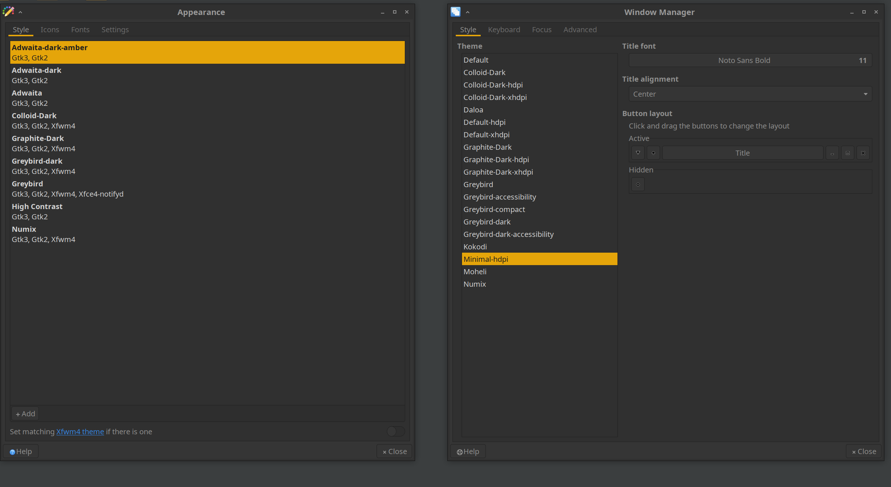

# HiDPI Amber Desktop

A compact dark desktop theme bundle built around a warm amber accent
(`#E5A50A`), square HiDPI window decorations, and predictable selected-text
contrast.



The bundle was assembled and tested on Xfce 4.20 at 144 DPI. It contains only
the components that are known to work together:

- **Adwaita-dark-amber** — GTK 2/3 theme based on Adwaita Dark
- **Minimal-hdpi** — square, gradient-free Xfwm4 decoration with 6 px borders
- **Xfce panel CSS** — flat task buttons with explicit current/attention states
- **GTK 3 fixes** — stable amber selections and correct nested-menu text colors
- **Minimal Amber** — Fcitx 5 Classic UI theme
- **Fcitx Qt QSS** — readable dark text on amber selections in the
  configuration utility

GTK 4/libadwaita and Qt application themes are deliberately out of scope.
They use different styling engines and are not made consistent by installing a
GTK 2/3 theme.

## Appearance

| Role | Value |
| --- | --- |
| Accent | `#E5A50A` |
| Text on accent | `#1C1C1C` |
| Main dark surface | `#1C1C1C` |
| Panel hover | `#454545` |
| Active task button | `#000000` |
| Urgent task button | `#E5A50A` |

The Xfwm4 decoration uses square corners, solid gray title bars, a 6 px frame
(1 px dark outer edge plus 5 px gray), and 24×24 px bottom resize handles.

## Requirements

- Xfce with Xfwm4
- GTK 2 and GTK 3 theme support
- Xfce Window Buttons plugin
- Fcitx 5 Classic User Interface (optional)
- `xfconf-query` for automatic activation

Package names vary by distribution. On Debian/Ubuntu, the relevant packages
normally include `xfce4-panel`, `xfwm4`, `gnome-themes-extra-data`,
`fcitx5`, and `fcitx5-config-qt`.

## Install

```sh
git clone https://github.com/RickoNoNo3/hidpi-amber-desktop.git
cd hidpi-amber-desktop
./scripts/install.sh --apply
```

`install.sh` copies the assets into the current user's home directory. Existing
files at the same managed paths are backed up once under:

```text
~/.local/state/hidpi-amber-desktop/originals/
```

Use `./scripts/install.sh` without `--apply` to install the files without
changing the active GTK/Xfwm4/Fcitx settings.

After activation, enable **Show flat buttons** in the Window Buttons plugin.
Restart GTK 3 applications that were already open so they reload the user CSS.

## Uninstall

```sh
./scripts/uninstall.sh
```

This removes the CSS import, restores files that existed before installation,
and restores the GTK, Xfwm4, and Fcitx settings captured by `apply.sh`.

To remove the assets without restoring captured settings:

```sh
./scripts/uninstall.sh --keep-settings
```

## Documentation

- [Design and modifications](docs/DESIGN.md)
- [Rebuilding and porting](docs/REBUILDING.md)
- [Migration guide](docs/MIGRATION.md)
- [Troubleshooting](docs/TROUBLESHOOTING.md)
- [Licensing and upstream attribution](LICENSE.md)

## Compatibility notes

- **GTK 4/libadwaita:** intentionally untouched. GNOME Calendar, Bottles, and
  similar applications retain libadwaita's own large radii and CSD styling.
- **Anki/Qt:** Anki's “Native Style” may still use Qt Fusion. GTK CSS cannot
  change Qt widget radii.
- **Client-side Fcitx preedit:** different toolkits draw embedded preedit text
  differently. `apply.sh` disables embedded preedit by default so Fcitx draws
  it consistently in its own panel.
- **Display scale:** the decoration targets approximately 144 DPI. It remains
  usable elsewhere, but title-button and border proportions may not be ideal.

## License

This is a mixed-license derivative bundle. The Adwaita and Fcitx-derived parts
remain under LGPL-2.1-or-later. Original scripts, documentation, CSS overrides,
and the Xfwm4 derivative are distributed under GPL-2.0-or-later. See
[LICENSE.md](LICENSE.md) and [NOTICE.md](NOTICE.md).
